# MainUI themes

Themes for [MainUI](https://github.com/marsinsanity/MainUI), the Android frontend for handhelds,
and the kit that draws them. Every theme is a normal OnionOS theme (it works on a Miyoo Mini too)
with its own fonts and its own picture for every system MainUI knows.

## Installing

- **MainUI**: Apps > Theme Downloader lists these themes first ("MainUI theme"). A installs one, Y
  installs and applies it. A theme whose installed copy is older than the one here shows "update".
- **By hand**: download `<theme>.zip` from the [`themes` release](https://github.com/MainUI-Android/themes/releases/tag/themes)
  and put it (or its folder) in `Themes/` on your device, then pick it in Apps > Theme Switcher.
- **OnionOS**: unzip the theme folder into `Themes/` on the SD card.

## Themes

<!-- gallery -->
<table>
<tr><td valign="top" width="50%">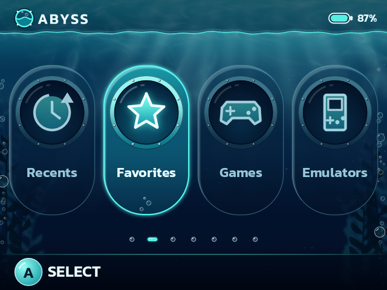<br><b>Abyss</b><br>Deep ocean: a sunlit turquoise surface sinking into the navy abyss, with porthole capsules and rising bubbles.</td><td valign="top" width="50%">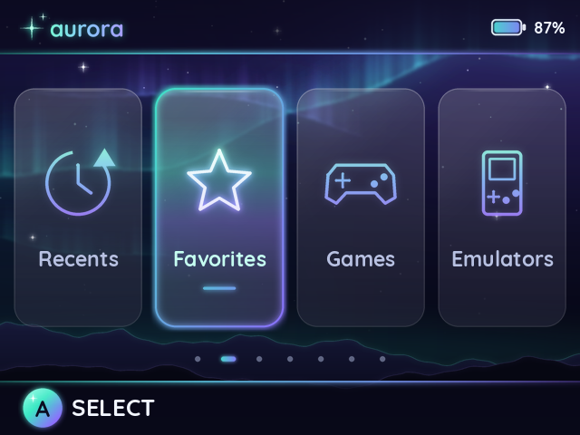<br><b>Aurora</b><br>Polar night: teal and violet aurora ribbons over a starry sky, with frosted glass cards and glowing line art.</td></tr>
<tr><td valign="top" width="50%">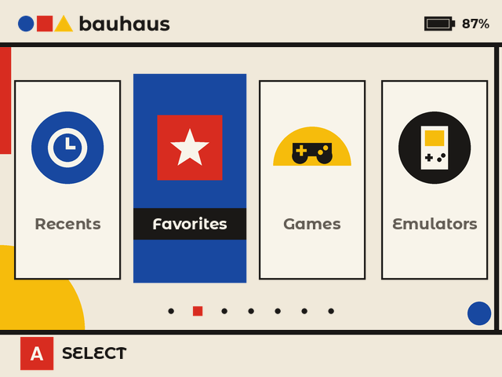<br><b>Bauhaus</b><br>A 1920s poster on warm paper: flat red, blue and yellow shapes, thick black rules, a geometric sans.</td><td valign="top" width="50%">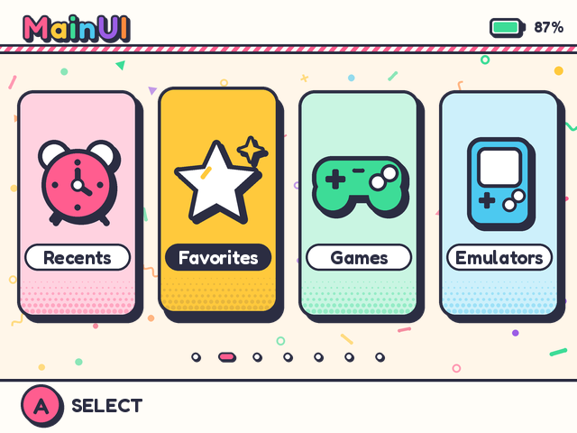<br><b>Candy</b><br>Bright, playful neo-brutalism: confetti on cream, candy colour blocks, thick ink outlines and hard shadows.</td></tr>
<tr><td valign="top" width="50%">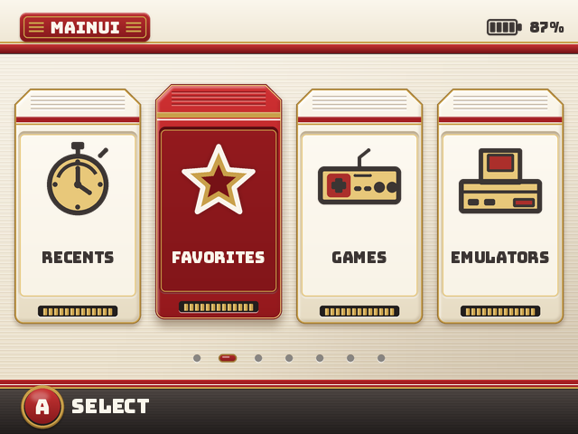<br><b>Cartridge</b><br>An 80s home console in ivory plastic with deep red and gold trim and chunky cartridge tiles.</td><td valign="top" width="50%">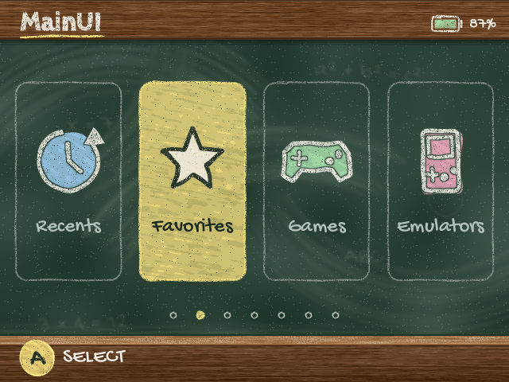<br><b>Chalkboard</b><br>A school blackboard: green slate, eraser smudges, a wooden frame and ledge, all drawn in dusty pastel chalk.</td></tr>
<tr><td valign="top" width="50%">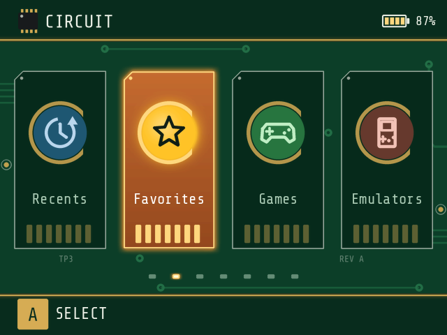<br><b>Circuit</b><br>A printed circuit board: green solder mask, copper traces, gold pads, white silkscreen; focus lights up like a live trace.</td><td valign="top" width="50%">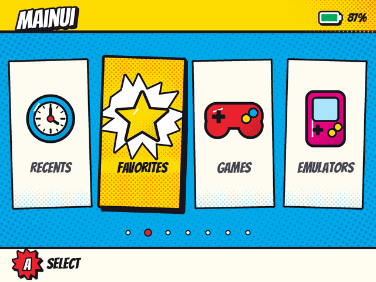<br><b>Comic</b><br>A pop-art comic page: cyan Ben-Day dots, bold ink, flat CMYK colour, caption boxes and a bursting yellow focus.</td></tr>
<tr><td valign="top" width="50%">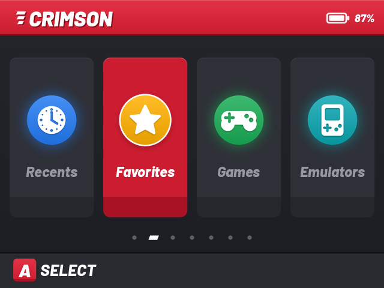<br><b>Crimson</b><br>Punchy flat dark: charcoal, a solid crimson header, bright glowing colour discs and heavy italic type.</td><td valign="top" width="50%">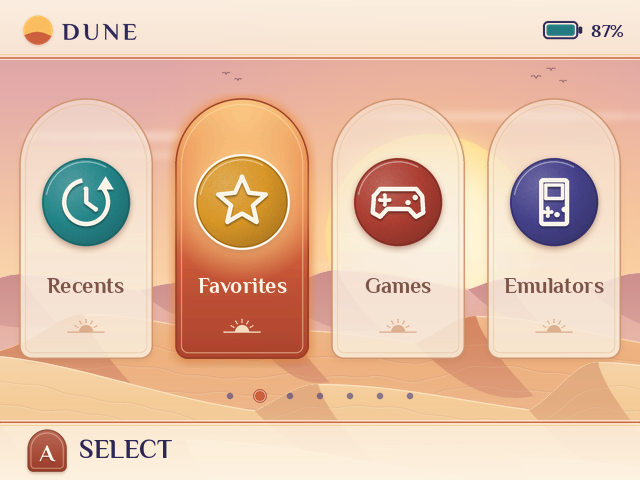<br><b>Dune</b><br>The desert at golden hour: layered dunes under a low sun, adobe-arch tiles and clay discs in indigo ink.</td></tr>
<tr><td valign="top" width="50%">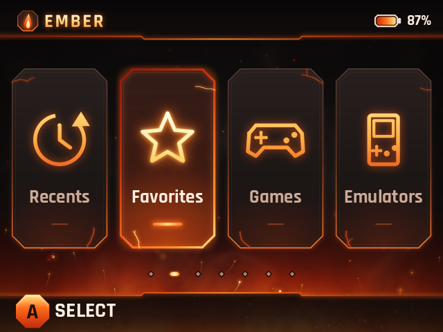<br><b>Ember</b><br>Charcoal and fire: basalt slabs with chamfered corners, rim-lit by a molten glow rising from below.</td><td valign="top" width="50%">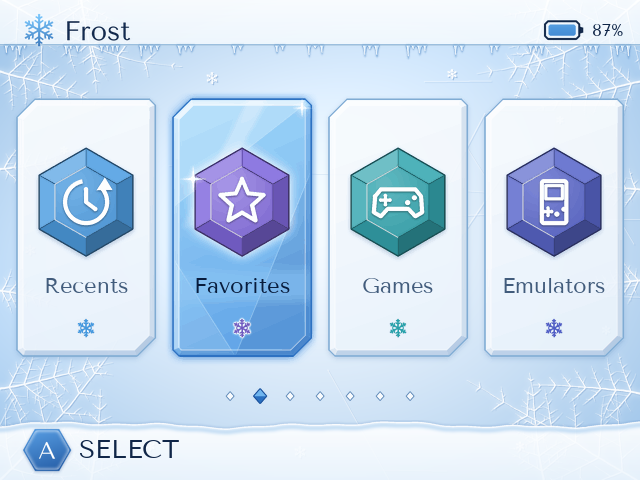<br><b>Frost</b><br>A frozen window pane: frost ferns on pale ice, crystal-cut frosted panels and cold gem icons that turn to clear blue ice.</td></tr>
<tr><td valign="top" width="50%">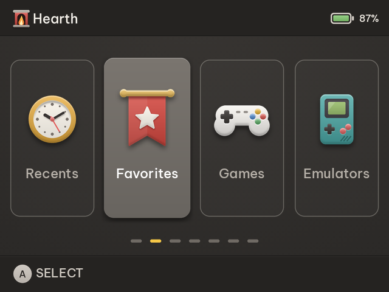<br><b>Hearth</b><br>Calm, cosy dark: warm charcoal, outlined cards, a raised grey card for focus and softly shaded full-colour pictures.</td><td valign="top" width="50%">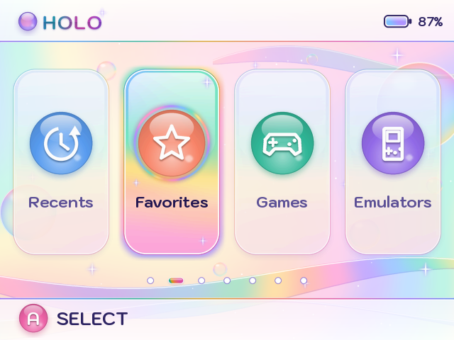<br><b>Holo</b><br>Y2K holographic: iridescent pearl foil, glossy jelly bubbles and sparkles, with crisp dark ink.</td></tr>
<tr><td valign="top" width="50%">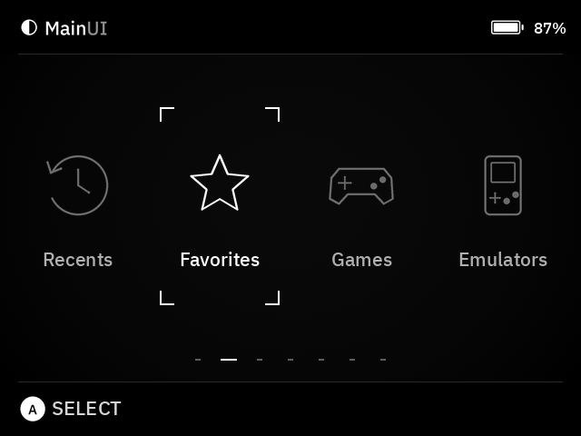<br><b>Mono</b><br>Pure black minimalism: hairline drawings, white focus brackets and lots of space.</td><td valign="top" width="50%">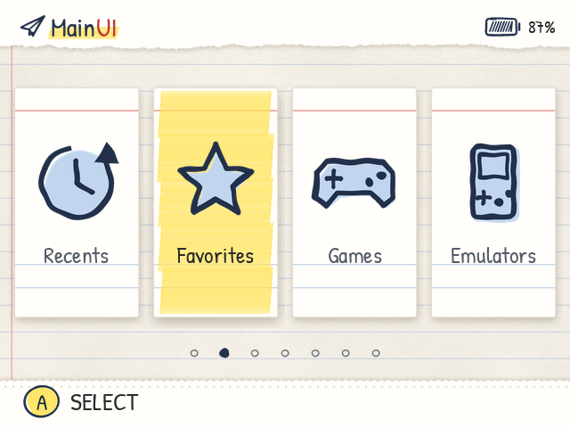<br><b>Paper</b><br>A notebook page: ruled cream paper, navy ink drawings, index cards and a yellow highlighter.</td></tr>
<tr><td valign="top" width="50%">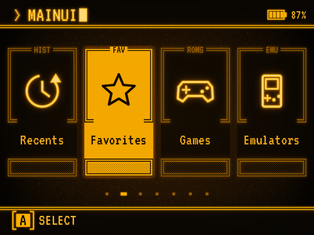<br><b>Phosphor</b><br>An amber CRT terminal: scanlines and soft bloom, double-line box frames and reverse-video cursors.</td><td valign="top" width="50%">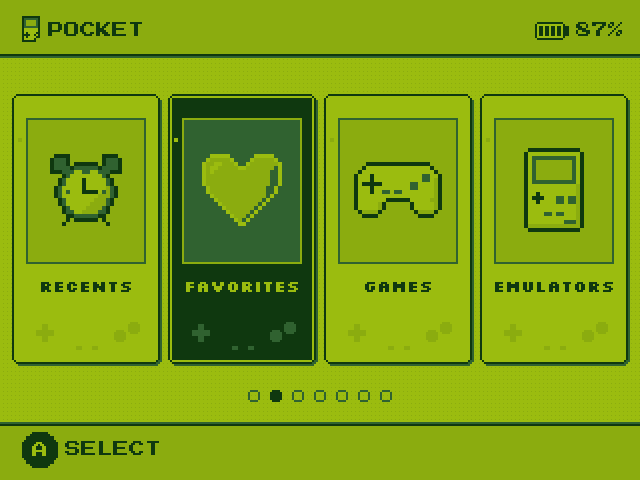<br><b>Pocket</b><br>A four-shade green LCD handheld: hard pixels, dot-matrix paper and inverted selections.</td></tr>
<tr><td valign="top" width="50%">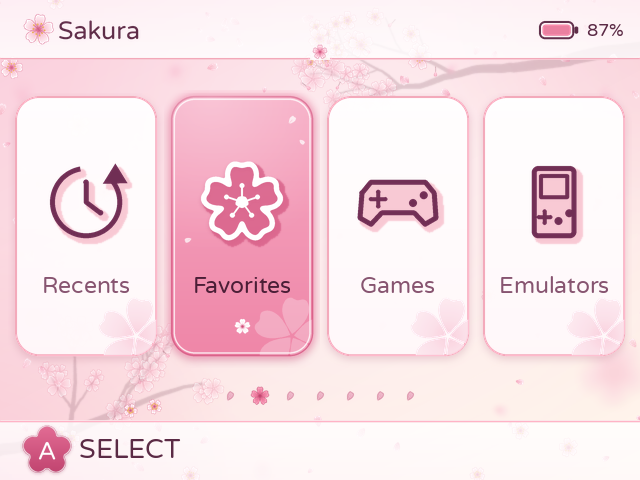<br><b>Sakura</b><br>Spring in pastel pink: drifting cherry petals, soft white cards edged in pink and plum ink.</td><td valign="top" width="50%">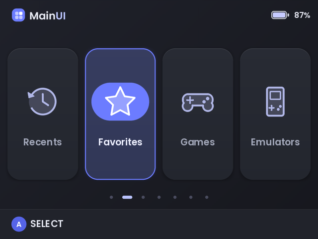<br><b>Slate</b><br>Modern Material-style dark: slate tonal surfaces, indigo pill selection and filled-tonal lavender icons.</td></tr>
<tr><td valign="top" width="50%">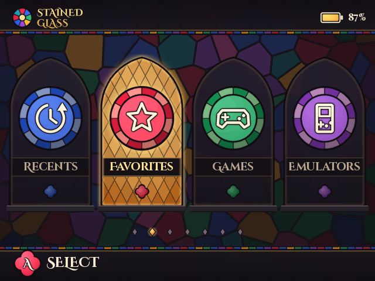<br><b>Stained Glass</b><br>A cathedral window at dusk: jewel glass in thick lead, gothic arches and roundels that light up gold when chosen.</td><td valign="top" width="50%">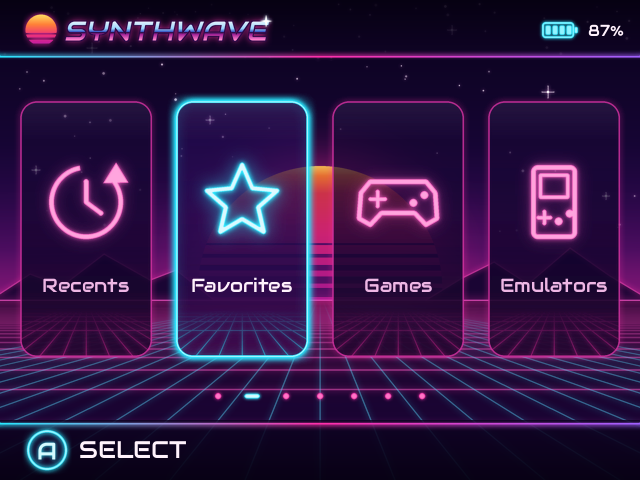<br><b>Synthwave</b><br>80s retro-futurism: a striped sunset sun over a neon grid, glass panels lit by glowing tubes.</td></tr>
</table>
<!-- /gallery -->

## Building

The themes are drawn by Python code (Pillow, numpy), nothing by hand:

```
pip install -r kit/requirements.txt
python3 kit/build.py                      # every theme, into dist/themes/
python3 kit/build.py frost --mock dist/mock   # one theme, plus mock screens of MainUI with it
```

`kit/build.py --release DIR` writes what MainUI's Theme Downloader reads (`catalog.json`,
`<id>.zip`, `<id>.png`); CI does that on every push to `main` and publishes them as the `themes`
release. `--mainui` also builds MainUI's own default theme, which MainUI bundles as
`app/src/main/assets/themes/MainUI`.

## Making a theme

A theme is one module, `kit/themes/<id>.py`, with `class Theme(Style)`. `kit/theme_kit.py` documents
every screen element, its size and how MainUI lays it out; its `Style` draws a plain theme, and a
theme overrides whatever it styles differently (background, bars, tiles, lists, pop-ups, buttons,
system icons...). The existing themes are worked examples. Then:

```
python3 kit/build.py <id> --mock dist/mock     # check: no PROBLEMS, and look at dist/mock/<id>-mock.png
python3 kit/build.py <id> --previews previews  # the picture for this page
python3 kit/build.py --gallery README.md       # the table above
```

Fonts go in `kit/fonts/` with their licence (SIL Open Font License fonts only). `kit/systems.json` is
a copy of MainUI's list of systems: copy it again when MainUI adds one, so every theme draws it.

## License

The themes, their artwork and the kit are licensed under the
[Creative Commons Attribution-NonCommercial 4.0 International License](https://creativecommons.org/licenses/by-nc/4.0/)
(CC BY-NC 4.0, see [LICENSE](LICENSE)): share and adapt them for any non-commercial purpose, with
credit to MainUI. The fonts in `kit/fonts/` (copied into each theme that uses one) are not covered by
it: they belong to their authors and are licensed under the SIL Open Font License 1.1, whose text
is next to each font.
